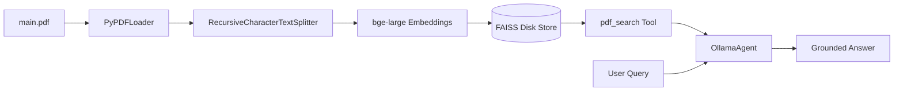

# LangChain & Ollama Testbed

A modular playground demonstrating **Agentic Tool Calling** and **Retrieval-Augmented Generation (RAG)** using **LangChain 1.4+** and local models powered by **Ollama**.

---

## Overview

This repository demonstrates two foundational patterns in modern AI application development, running completely locally:

1. **Agentic Tool Calling (`ollama_usage/` & `tools/`)**: An autonomous agent powered by local models (e.g., Llama 3.2 3B) capable of reasoning and executing external tools (such as live weather retrieval) through iterative ReAct loops.
2. **Local RAG Pipeline (`RAG_usage/`)**: An end-to-end question-answering pipeline over academic documents (PDFs). It extracts pages, chunks them semantically, computes dense embeddings using BGE-Large, and persists a FAISS vector store on disk so that subsequent queries start up instantly.

---

## Project Structure

```text
LangChainTest/
├── documents/
│   └── main.pdf                     # Target document (place your own PDF here)
├── ollama_usage/
│   ├── OllamaAgent.py               # Reusable OllamaAgent class & model enum
│   └── OllamaRequestTest.py         # Standalone script for direct Ollama tests
├── RAG_usage/
│   ├── DocumentsFromThesis.py       # PDF document loading & recursive chunking
│   ├── OllamaEmbed.py               # BGE-Large embeddings & persistent FAISS vector store
│   └── RAGOrchestrator.py           # RAG pipeline coordinator & retriever tool agent
├── saved_index/                     # Persistent FAISS index files (index.faiss, index.pkl)
├── tools/
│   └── tools.py                     # Custom tools (e.g., live weather via wttr.in)
├── main.py                          # Main entry point running agent & RAG demos
├── pyproject.toml                   # Project metadata & dependencies
└── README.md
```

---

## Tech Stack & Prerequisites

* **Language**: Python 3.13+
* **Package Manager**: [uv](https://github.com/astral-sh/uv) (or standard `pip`)
* **Core Frameworks**:
  * `langchain` (>= 1.4.4)
  * `langchain-ollama` (>= 1.1.0)
  * `langchain-community` & `faiss-cpu`
  * `pypdf` & `langchain-text-splitters`
* **Local LLM Engine**: [Ollama](https://ollama.com/)

### Required Ollama Models
Ensure Ollama is running and the following models are installed:

```bash
# Generative Model (for reasoning & answering)
ollama pull hf.co/bartowski/Llama-3.2-3B-Instruct-GGUF:latest

# Embedding Model (for dense vector representations)
ollama pull bge-large
```

---

## Installation & Setup

1. **Clone the repository:**
   ```bash
   git clone https://github.com/your-username/LangChainTest.git
   cd LangChainTest
   ```

2. **Install dependencies:**
   Using `uv`:
   ```bash
   uv sync
   ```
   Or using standard `pip`:
   ```bash
   python -m venv .venv
   source .venv/bin/activate  # On Windows: .venv\Scripts\activate
   pip install -e .
   ```

3. **Ensure Ollama is active:**
   Verify by visiting `http://localhost:11434` or running:
   ```bash
   ollama list
   ```

4. **Add your PDF Document:**
   The RAG pipeline expects a PDF document to index. Place your PDF inside the `documents/` directory and name it `main.pdf`:
   ```bash
   # Ensure the directory exists and copy your document
   mkdir documents
   cp path/to/your/document.pdf documents/main.pdf
   ```
   *(Note: `documents/main.pdf` is git-ignored to keep your personal files private. You can also customize the file path in `RAG_usage/RAGOrchestrator.py` via `PDF_PATH`).*

---

## How It Works

### 1. Agentic Tool Calling
The `OllamaAgent` class encapsulates `create_agent` from LangChain. Given tools decorated with `@tool`, the LLM dynamically inspects function signatures and chooses when to call them:

```python
from ollama_usage.OllamaAgent import Models, OllamaAgent
from tools import tools

# Initialize agent with custom tools
agent = OllamaAgent(Models.LLAMA, tools=tools.get_tools())

# Query the agent
response = agent.askLLM("What is the weather at Brescia?")
print(response)
```

### 2. Document RAG Pipeline



1. **Extraction & Chunking (`DocumentsFromThesis.py`)**: `PyPDFLoader` extracts text while preserving page-level metadata. `RecursiveCharacterTextSplitter` segments text into 1,000-character chunks with overlap.
2. **Vector Indexing & Persistence (`OllamaEmbed.py`)**: Chunks are embedded with `bge-large` and indexed into FAISS. The index is saved in `saved_index/` (`index.faiss` and `index.pkl`). On future runs, the index is loaded directly in milliseconds, skipping redundant PDF processing and embedding computations.
3. **RAG Orchestration (`RAGOrchestrator.py`)**: The retriever is exposed to an `OllamaAgent` as a tool (`pdf_search`). The model queries the thesis and synthesizes citations strictly from the retrieved context.

---

## Running the Demo

Execute the entry point:

```bash
uv run python main.py
# or with active virtual environment:
python main.py
```

`main.py` will:
1. Initialize the `OllamaAgent` and query the weather tool for Brescia.
2. Load/verify the FAISS index for `documents/main.pdf`.
3. Query the thesis with:
   > *"What are the overall performance of Answer Refinement?"*
   
   This is a generic question because I used my thesis as reference. Use your own document ask the RAG your questions by changing it in the `main.py` (see _RAG_QUESTION_ variable at the top)
4. Output the grounded answer generated by the model.

---

## License

This project is licensed under the MIT License.
